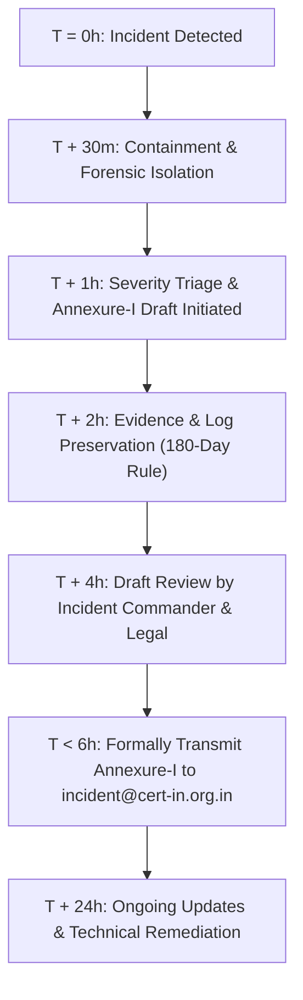

# CERT-In Cyber Incident Reporting — Standard Operating Procedure (SOP)
## Mandatory Compliance with Direction No. 20(3)/2022-CERT-In under Section 70B(6) of the IT Act, 2000

---

### Document Control
- **Entity**: Hiralal & Sons Sales Pvt. Ltd. (Platform Owner) & ALGIONS AI LABS PRIVATE LIMITED (Technical Operator)
- **Application**: Hiralal & Sons Rewards Platform (`hiralal`)
- **Authority**: Indian Computer Emergency Response Team (CERT-In), Ministry of Electronics and Information Technology (MeitY), Government of India
- **Mandate**: Direction No. 20(3)/2022-CERT-In dated 28 April 2022
- **Effective Date**: 2026-11-01
- **Review Cycle**: Annual or immediately following any security incident

---

## 1. Statutory Mandate & Strict 6-Hour Timeline

Under **Sub-section (6) of Section 70B of the Information Technology Act, 2000** and **CERT-In Direction No. 20(3)/2022-CERT-In**, all service providers, intermediaries, data centres, body corporate and digital service operators in India are legally mandated to report cyber security incidents to CERT-In **within 6 (six) hours of noticing or being brought to notice of such incidents**.

> [!CAUTION]
> **STRICT COMPLIANCE DEADLINE**: Incident reporting to CERT-In must occur within **6 hours** of initial detection. Failure to report within 6 hours constitutes an offense punishable under Section 70B(7) of the IT Act with imprisonment up to one year, or a fine up to ₹1,00,000, or both.

---

## 2. CERT-In Contact Channels

All incidents must be formally submitted to CERT-In through one of the designated channels:

- **Primary Incident Reporting Email**: `incident@cert-in.org.in`
- **Toll-Free Helpline (24x7)**: `1800-11-4949`
- **Direct Phone**: `+91-11-24669949`
- **Facsimile (Emergency Fax)**: `+91-11-24669969` / `1800-11-6969`
- **Web Reporting Portal**: `https://www.cert-in.org.in`

---

## 3. Scope of Reportable Cyber Security Incidents (Annexure I)

The platform must immediately report any occurrence matching any of the 20 incident categories specified by CERT-In:

1. **Targeted scanning / probing** of critical networks, infrastructure, or APIs.
2. **Compromise of critical systems / information** (PostgreSQL database, Redis cache, JWT signing keys, master secrets).
3. **Unauthorized access of IT systems / data** (unauthorized access to admin accounts, user wallets, or KYC vaults).
4. **Defacement or intrusion** into web services, mobile API endpoints, or admin dashboards.
5. **Malicious code attacks** (viruses, trojans, bots, ransomware, cryptominers, supply chain backdoor in npm dependencies).
6. **Attacks on servers and infrastructure** (database, reverse proxy, mail/SMS gateways, DNS infrastructure).
7. **Identity theft, spoofing, and phishing attacks** targeting platform users, bill review admins, or corporate credentials.
8. **Denial of Service (DoS) and Distributed Denial of Service (DDoS)** attacks degrading or incapacitating platform access.
9. **Attacks on Critical Information Infrastructure (CII)** or operational systems.
10. **Attacks on application layer** (e.g. SQL injection attempts, IDOR vulnerabilities, GraphQL/REST authentication bypass, mass invoice replay).
11. **Data Breach / Data Leak** (unauthorized exposure or exfiltration of customer PII, PAN records, mobile numbers, or financial transactions).
12. **Attacks on IoT devices** or connected warehouse terminals.
13. **Attacks affecting Digital Payment systems** (RazorpayX integration tampering, UPI beneficiary spoofing, fake webhook replays, double-spend attempts).
14. **Attacks through malicious mobile applications** (tampered APKs, repackaged clones circulating outside Google Play).
15. **Fake mobile applications** masquerading as the official *Hiralal & Sons Rewards* app.
16. **Unauthorized access to corporate social media, domain registrar, or DNS accounts**.
17. **Attacks or suspicious activities affecting cloud infrastructure** (Cloudflare, AWS, Hostinger VPS, R2 Object Storage).
18. **Attacks or malicious activities affecting AI/ML pipelines or OCR invoice extraction engines**.
19. **Ransomware or extortion attempts** affecting financial records or backups.
20. **Security incidents affecting critical third-party vendors or supply chains** (e.g., compromise of MSG91, SignCare, or RazorpayX).

---

## 4. Incident Response Team & Responsibilities

| Role | Designee | Key Responsibilities |
| :--- | :--- | :--- |
| **Incident Commander** | Lead Systems Architect / CTO | Declares incident severity, directs technical containment, coordinates forensic preservation. |
| **Technical Operations Lead** | Lead Backend / DevOps Engineer | Isolates affected nodes, preserves disk images and memory dumps, ensures NTP synchronization. |
| **Compliance & Grievance Officer** | Designated Legal / Privacy Officer | Drafts Annexure-I report, submits report to `incident@cert-in.org.in` before T+6h, interfaces with authorities. |
| **Communications Officer** | Platform Operations Administrator | Manages stakeholder communications, coordinates with Hiralal & Sons management. |

---

## 5. Rapid Incident Response Workflow (0 to 6 Hours)



### Phase 1: Detection & Triage (T + 00:00 to T + 00:30)
1. Security alert raised via automated SIEM, Cloudflare WAF alert, error log anomaly, or manual user report.
2. Incident Commander immediately logs:
   - Detection Timestamp (IST).
   - Systems affected (`backend`, `postgres`, `redis`, `admin`, `nginx`, `mobile`).
   - Incident type classification (from 20 Annexure-I categories).

### Phase 2: Containment & Forensic Isolation (T + 00:30 to T + 02:00)
1. **Isolate without destroying volatile evidence**:
   - If a host or container is compromised, disconnect network ingress without rebooting if memory analysis is required.
   - Revoke compromised API keys, JWT master secrets, or administrative sessions immediately.
2. **Preserve Forensic Logs**:
   - Ensure system clock is synchronized with `time.nic.in` / `time.nplindia.org` (`timedatectl status`).
   - Securely archive Nginx access logs (`/var/log/nginx/access.log`), system logs (`journalctl`), PostgreSQL query logs, and application audit logs (`AuditLog` table).
   - Ensure logs comply with the mandatory **180-day retention requirement** within Indian jurisdiction.

### Phase 3: Drafting CERT-In Annexure-I Incident Report (T + 02:00 to T + 04:30)
Complete the official Annexure-I reporting template (provided in Section 6 below) with all facts known at the time of drafting. If root cause analysis is still underway, state preliminary findings — **do not delay the 6-hour report waiting for complete resolution**.

### Phase 4: Submission & Confirmation (T + 04:30 to T + 06:00)
1. Send encrypted or signed email to `incident@cert-in.org.in` with Subject:
   `[INCIDENT REPORT - SECTION 70B] Hiralal & Sons Sales Pvt. Ltd. - <Incident Type> - <Date>`
2. Follow up with telephone confirmation via 24x7 helpline: `1800-11-4949` / `+91-11-24669949`.
3. Record confirmation ticket ID provided by CERT-In in the internal incident log.

---

## 6. Official CERT-In Incident Reporting Template (Annexure-I)

Submit the following structured document to `incident@cert-in.org.in`:

```text
================================================================================
CERT-IN INCIDENT REPORT FORM (ANNEXURE-I)
Pursuant to CERT-In Cyber Security Directions (Direction No. 20(3)/2022-CERT-In)
================================================================================

1. GENERAL DETAILS
--------------------------------------------------------------------------------
Name of the Organization: Hiralal & Sons Sales Pvt. Ltd.
Technical Operator: ALGIONS AI LABS PRIVATE LIMITED
Sector / Category: Retail / E-Commerce / Customer Loyalty & Rewards
Physical Address: Plot 1, Industrial Area, Jaipur, Rajasthan - 302001, India
Website / Domain: https://rewards.hiralalandsons.com

2. CONTACT PERSON DETAILS
--------------------------------------------------------------------------------
Designated Contact Person: Grievance & Compliance Officer
Designation: Chief Information Security Officer / Legal Grievance Officer
Mobile Phone Number: +91-XXXXXXXXXX (24x7 reachable)
Landline / Alternate Phone: +91-XXXXXXXXXX
Email Address: compliance@hiralalandsons.com / legal@algions.com

3. INCIDENT DETAILS
--------------------------------------------------------------------------------
Date and Time of Occurrence: YYYY-MM-DD HH:MM:SS IST
Date and Time of Detection: YYYY-MM-DD HH:MM:SS IST
Reporting Timestamp to CERT-In: YYYY-MM-DD HH:MM:SS IST (Within 6 hours)
Incident Type (from Annexure-I): [Specify from 1-20, e.g., (11) Data Breach / Data Leak]
Severity Level: [CRITICAL / HIGH / MEDIUM / LOW]

4. TECHNICAL DETAILS & AFFECTED ASSETS
--------------------------------------------------------------------------------
Affected Systems / Endpoints:
  - System Hostname / IP: [e.g., Hostinger KVM 2 VPS / Production API 185.XXX.XXX.XXX]
  - Operating System: Ubuntu 24.04 LTS (x86_64)
  - Applications Affected: Backend Node.js API / PostgreSQL 16 / Nginx Reverse Proxy
  - NTP Time Server Reference: time.nic.in / time.nplindia.org
Source IP / Vectors Observed (if known): [IP addresses, User-Agents, Indicators of Compromise]
Impact on Confidentiality: [YES / NO - Details of data affected]
Impact on Integrity: [YES / NO - Financial ledger, wallets, or invoice records affected]
Impact on Availability: [YES / NO - Downtime duration if applicable]

5. INCIDENT SUMMARY & DESCRIPTION
--------------------------------------------------------------------------------
[Provide concise, chronological summary of what transpired, how the intrusion occurred,
what payloads or anomalous calls were detected, and which database tables or endpoints
were targeted.]

6. CONTAINMENT & MITIGATION ACTIONS TAKEN
--------------------------------------------------------------------------------
[Detail containment measures executed:
  1. Network isolation / Cloudflare WAF rule activation
  2. Immediate key revocation and session termination
  3. Database rollback or read-only locking if applicable
  4. Log preservation and disk image creation]

7. DATA IMPACT EVALUATION
--------------------------------------------------------------------------------
Was Customer PII compromised? [YES / NO]
Were Financial / Payment Records compromised? [YES / NO]
Total Estimated Users Affected: [Count]

8. REMEDIATION & NEXT STEPS
--------------------------------------------------------------------------------
[Summary of ongoing technical remediation, patches applied, and expected time
for subsequent detailed forensic report submission.]
================================================================================
```

---

## 7. Supporting Statutory Requirements

### 7.1 Mandatory Time Synchronization (Section 4(i))
- All production servers, containers, and database nodes must have system clocks synchronized with the NTP servers of:
  - **National Informatics Centre (NIC)**: `time.nic.in`
  - **National Physical Laboratory (NPL)**: `time.nplindia.org`
- Verify synchronization on production host:
  ```bash
  timedatectl timesync-status
  ```

### 7.2 Mandatory 180-Day Log Retention (Section 4(ii))
- In accordance with Section 4(ii) of the Directions, all ICT system logs (Nginx ingress logs, Docker daemon logs, application JSON logs, PostgreSQL WAL/audit logs, authentication and session events) **must be securely retained for 180 consecutive days within Indian jurisdiction**.
- Logs must be encrypted at rest and protected from tampering or deletion during the statutory retention window.
